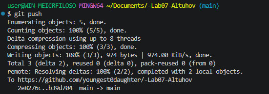
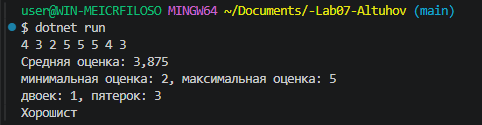

# Практическая работа №7

**ФИО:** Алтухов
**Группа:** ИСП-241
**Дата:** 19.11.2026  

## Что изучено
- Научился создавать одномерные массивы.
- Разобрался в разнице между циклами: `foreach` удобно использовать только для чтения всех элементов подряд, а `for` нужен, когда требуется индекс или изменение значений внутри массива.
- Освоил базовые алгоритмы обработки массивов без встроенных методов: подсчёт суммы и среднего арифметического, поиск минимума и максимума, а также фильтрацию элементов по условию.

